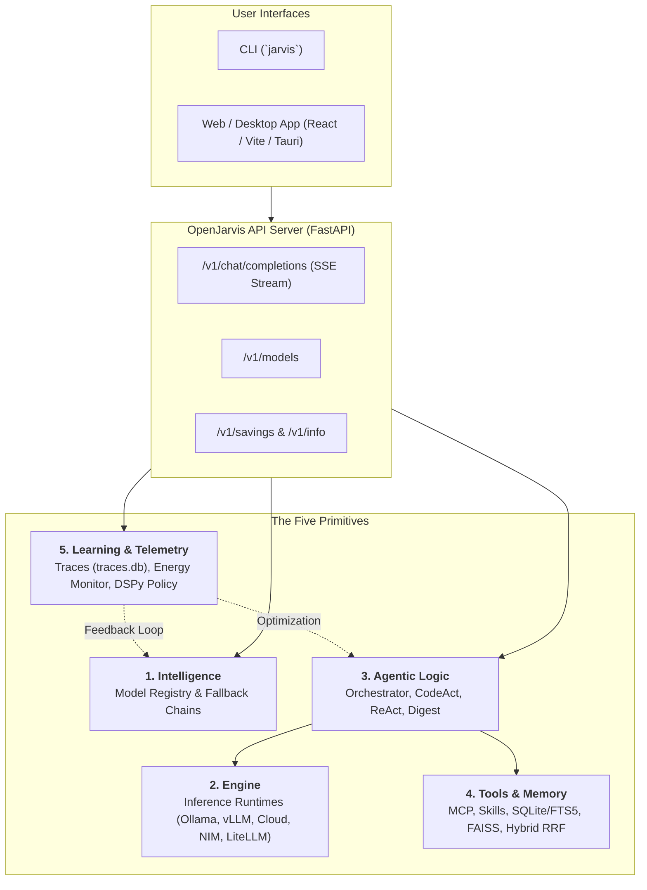
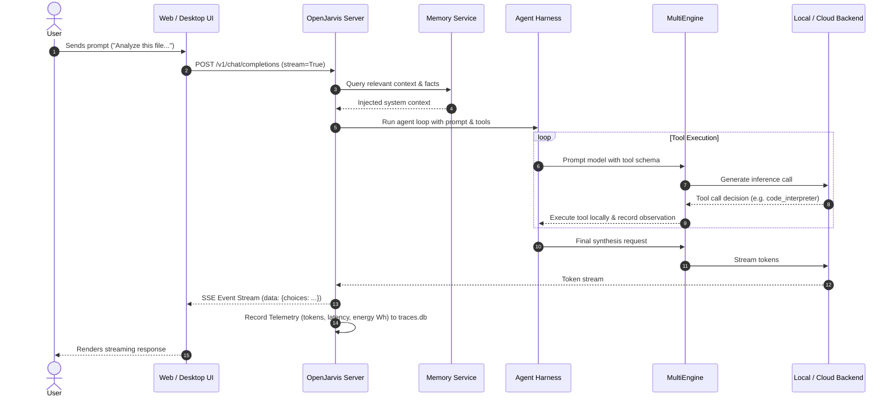

# OpenJarvis Architecture

> **Personal AI, On Personal Devices.**  
> Open-source framework for building, evaluating, and self-improving on-device personal AI agents.

---

## 1. Overview & Vision

Modern personal AI agents frequently route user queries to remote cloud providers. OpenJarvis is built on research from **Stanford SAIL** (Hazy Research & Scaling Intelligence Lab, [arXiv:2605.17172](https://arxiv.org/abs/2605.17172)) showing that **on-device language models can already handle the vast majority (~88.7%) of daily chat, reasoning, and coding queries**.

OpenJarvis provides the full software foundation to make local-first personal AI practical:
- **Local-first execution:** Runs inference on local hardware (Ollama, vLLM, llama.cpp, MLX) by default.
- **Smart routing & fallback:** Gracefully routes to accelerated cloud backends (Google Gemini, OpenAI, Anthropic, NVIDIA NIM, or LiteLLM providers like Groq) when higher capacity or fallback is needed.
- **Trace-driven learning:** Treats latency, dollar cost, and real hardware energy consumption (Joules/Watt-hours) as first-class constraints alongside accuracy.

---

## 2. High-Level Architecture

The system is organized around **five core primitives** coordinated through a local OpenAI-compatible server and trace telemetry:



---

## 3. The Five Core Primitives

### 1. Intelligence
* **Purpose:** Handles model definitions, capability specifications, and catalog management.
* **Key Components:**
  * `ModelRegistry`: In-memory registry populated with built-in models (`BUILTIN_MODELS`) and dynamically discovered runtime models.
  * Metadata tracking: Parameter size, context length, minimum VRAM, quantization formats, and supported engines.
  * `IntelligenceConfig`: Configured defaults such as `default_model`, `fallback_model`, and generation parameters (`temperature`, `top_p`, `max_tokens`, `repetition_penalty`).
  * Fallback chains: Ordered list of fallback models and engine providers if primary inference fails.

### 2. Engine
* **Purpose:** The inference runtime layer abstracting model execution.
* **Interface (`InferenceEngine` ABC):**
  * `generate(messages, model, ...)`: Non-streaming completion.
  * `stream(messages, model, ...)`: Token-by-token async stream.
  * `list_models()`: Discovered models available on this backend.
  * `health()`: Quick connectivity check.
* **Supported Backends:**
  * **Local Engines:** `OllamaEngine`, `VllmEngine`, `SglangEngine`, `LlamaCppEngine`, `MlxEngine`, `AppleFMEngine`, `ExoEngine`, `NexaEngine`, `UzuEngine`.
  * **Cloud Engine (`CloudEngine`):** Native direct SDK/HTTP integration for Google (Gemini), OpenAI, Anthropic, DeepSeek, MiniMax, OpenRouter, Atlas Cloud, and Codex.
  * **NVIDIA NIM Engine (`NIMEngine`):** NVIDIA-hosted (`integrate.api.nvidia.com`) or self-hosted NIM microservices.
  * **LiteLLM Engine (`LiteLLMEngine`):** Unified bridge for 100+ providers (e.g. Groq, Together, Mistral, Cohere) using the `provider/model` convention.
  * **`MultiEngine`:** Aggregates all healthy discovered engines under a single uniform interface, automatically dispatching requests to whichever backend hosts the specified model.

### 3. Agentic Logic
* **Purpose:** Autonomous task execution, reasoning loops, and multi-turn workflows.
* **Hierarchy:**
  * `BaseAgent` (ABC): Core prompt formatting and execution lifecycle.
  * `ToolUsingAgent`: Subclass enabling dynamic tool discovery and tool-call loops.
* **Built-in Agents:**
  * `OrchestratorAgent`: Multi-turn reasoning with automatic tool selection and function calling.
  * `NativeOpenHandsAgent`: CodeAct agent that generates and executes Python code directly.
  * `NativeReActAgent`: Classic Thought-Action-Observation loop.
  * `MorningDigestAgent`: Scheduled agent pulling calendar, emails, and news to generate spoken briefings.
  * `DeepResearchAgent`: Multi-hop research pipeline with web queries and document citations.
  * `SimpleAgent`: Lightweight single-turn conversational assistant without tools.
  * `SandboxedAgent`: Wraps agents in Docker/Podman containers for safe arbitrary code execution.

### 4. Tools & Memory
* **Tools:**
  * Standard built-in tools: Python execution (`code_interpreter`), file read/write, calculator, web search (Tavily, DuckDuckGo), git operations.
  * **MCP (Model Context Protocol):** Integrates external MCP tool servers seamlessly.
  * **Skills:** Conforms to the open `agentskills.io` standard, allowing dynamic skill importing from community catalogs (e.g. Hermes, OpenClaw).
* **Memory & Storage:**
  * Persistent knowledge stores with document chunking, embeddings, and context injection.
  * Multiple search backends: SQLite/FTS5 (zero-dependency default), FAISS (dense vectors), ColBERTv2 (late interaction), BM25, and Hybrid RRF.
  * Context injection: Automatically enriches user prompts with relevant facts and historical context.

### 5. Learning & Telemetry
* **Purpose:** Continuous evaluation, telemetry tracking, and performance optimization.
* **Hardware Energy Monitoring:**
  * Directly probes physical hardware power draw (Joules, Watts, Watt-hours) via NVIDIA NVML, Apple Silicon counters, or Intel/AMD RAPL.
* **Cost Accounting:**
  * Calculates real dollar savings by comparing local token throughput against commercial cloud API pricing.
* **Traces & Improvement:**
  * Records step-by-step agent traces in `traces.db`.
  * Feeds execution data into optimization policies (DSPy, prompt tuning, and learned routing).

---

## 4. Query Execution Flow



---

## 5. Repository Structure

```
OpenJarvis/
├── src/openjarvis/               # Core Python framework
│   ├── agents/                   # Agent implementations (Orchestrator, CodeAct, ReAct)
│   ├── cli/                      # Command-line commands (`jarvis serve`, `doctor`, `init`)
│   ├── core/                     # Central types, configuration, and registry patterns
│   ├── engine/                   # Inference engines (Ollama, vLLM, NIM, Cloud, LiteLLM, Multi)
│   ├── intelligence/             # Model catalog and hardware capability specs
│   ├── memory/                   # Knowledge storage, vector search, and context injection
│   ├── server/                   # FastAPI server, cloud router, and SSE streaming bridge
│   ├── telemetry/                # Hardware energy monitors (NVML, RAPL) and cost savings
│   └── tools/                    # Tool registry, built-in tools, and MCP client
├── frontend/                     # Web & Desktop GUI (React 19, Tailwind CSS, Vite)
├── desktop/                      # Tauri desktop shell packaging (.exe, .dmg, .AppImage)
├── rust/                         # High-performance Rust extensions (parsing, token counters)
├── configs/                      # Starter configuration presets and config.toml
├── docs/                         # MkDocs architecture, installation, and user guides
└── tests/                        # Comprehensive test suite (unit, integration, benchmark)
```

---

## 6. Configuration & Extensibility

OpenJarvis uses a centralized configuration file located at `~/.openjarvis/config.toml` (or `configs/openjarvis/config.toml`):

* Extensible plugins and backends use Python's decorator-based **Registry Pattern**:
  ```python
  from openjarvis.core.registry import EngineRegistry, AgentRegistry, ToolRegistry

  @EngineRegistry.register("custom_backend")
  class CustomEngine(InferenceEngine):
      ...
  ```
* All configuration sections align directly with the five primitives:
  * `[intelligence]`: Model names, fallbacks, sampling parameters.
  * `[engine]`: Backend ports, hosts, and active engine selections (`[engine.ollama]`, `[engine.vllm]`, `[engine.nim]`).
  * `[agent]`: Active agent type, turn limits, enabled tools.
  * `[tools.storage]`: Memory databases and retrieval thresholds.
  * `[learning]` / `[telemetry]`: Telemetry db path, GPU poll interval, and optimization policies.
